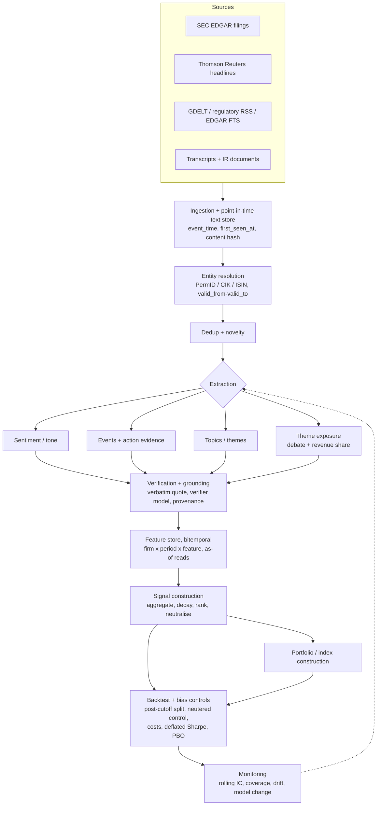

# LLM text signals for investment strategies

How asset managers, index providers, academics and open-source projects use LLM-based
information extraction, sentiment and theme extraction to build investment strategies. The
doc then turns that into a methodology review, a reference architecture and a phased
implementation plan for this repo.

Status: **deep review, 2026-10-13.** It replaces the initial scan from the same day; the facts
from that scan are kept and corrected where a primary source disagreed (see
[Corrections to the initial scan](#corrections-to-the-initial-scan)).

How to read the evidence tags:

- **[verified]**: read in the owner's own document (paper full text, firm page, methodology PDF).
- **[secondary]**: read only in slides, a discussant's deck, an abstract listing or a trade-press article.
- **[marketing]**: a performance or capability claim with no method or numbers behind it.
- **[not verified]**: the source could not be opened (SSRN returned 403 throughout this pass),
  or the claim could not be traced back to its owner.

---

## 1. Summary

1. **Headline sentiment from a strong LLM predicts short-horizon returns, but only in a narrow
   slice of the market.** Lopez-Lira & Tang (v6, Oct 2025) score headlines with GPT-4 and test
   only on news published after GPT-4's training cutoff. They get a drift long-short Sharpe of
   2.97 equal-weighted. The same signal reaches only 0.56 value-weighted, the effect is gone
   after about two days, and it is unprofitable at 20 bps round-trip.
   [verified](https://arxiv.org/pdf/2304.07619v6)
2. **That edge is shrinking.** In the same paper the Sharpe falls from 6.54 (2021Q4) to 1.22
   (Jan–May 2024). The authors read this as linked to LLM adoption, but call the link
   "suggestive". [verified](https://arxiv.org/pdf/2304.07619v6)
3. **Look-ahead bias is the defining methodological risk.**
   - Prompts such as "ignore what you know after date X" demonstrably fail.
   - Name masking is reversible: 70–100% of firms are re-identified.
   - The defensible designs are post-cutoff evaluation, time-consistent models (ChronoBERT,
     ChronoGPT, DatedGPT) and a measured anonymisation or memorisation diagnostic.
   - Sources: [Sarkar & Vafa](https://conference.nber.org/conf_papers/f205530/f205530.pdf),
     [Lopez-Lira, Tang & Zhu](https://arxiv.org/abs/2504.14765),
     [He et al.](https://arxiv.org/abs/2502.21206)
4. **Time-consistent models cost little in accuracy.** ChronoGPT (real-time vintages) has a
   long-short Sharpe of 4.92, against 4.90 for Llama 3.1, on next-day news returns. Weights are
   public under MIT. [verified](https://arxiv.org/html/2502.21206v3)
5. **Embeddings plus a supervised head is the academic workhorse**: Chen, Kelly & Xiu; He et
   al.; Ke, Kelly & Xiu's SESTM.
   - Larger models and ensembles help.
   - Labels are short-window returns (3-day or next-day).
   - The head is ridge or logistic, re-estimated on rolling windows.
   - Caveat: the full Chen–Kelly–Xiu paper could not be opened; see §2.2.
6. **The slower signals fit this repo better than headline trading.** Examples:
   - Earnings-call extraction of corporate *plans*, such as capex direction ([Jha et al.](https://www.nber.org/system/files/working_papers/w32161/w32161.pdf)).
   - Exposure measures (political risk, climate, AI).
   - Theme attention.

   Their horizons run from a quarter to a year, which matches a monthly backtest engine and a
   thematic index, not an intraday book.
7. **Industry thematic processes are LLM-assisted and human-supervised, and they publish no
   backtests.**
   - BlackRock's Thematic Robot and iShares THRO: an LLM finds direct and indirect exposures,
     the PM sets priors and corrects errors, and an optimiser builds the basket.
   - MSCI: a positive agent and a skeptic agent must both agree. The exposure number is revenue
     share, computed outside the LLM.
   - Robeco and Solactive say "NLP", not "LLM".
   - Sources: [BlackRock](https://www.blackrock.com/institutions/en-us/insights/ai-investing),
     [MSCI](https://www.msci.com/research-and-insights/blog-post/leveraging-language-models-to-capture-investment-strategies)
8. **A theme should pass a return-based test before it is treated as investable.** Candès,
   Hastie, Hogan, Kahn, Luo & Spector (FAJ 2025) define a theme by significant transient
   correlation of residual returns. Baskets that pass carry more risk than the risk model
   predicts, and they trend. Baskets that fail do not.
   [verified, abstract](https://rpc.cfainstitute.org/research/financial-analysts-journal/2025/thematic-investing-risk-based-perspective)
9. **This repo already has most of the pipeline.** It has grounded LLM sentiment scoring
   (`backend/arp/replication/sentiment_scoring.py`), a `TEXT_SENTIMENT` signal type, deflated
   Sharpe, PBO via CSCV, the theme debate and emerging-theme tagging. The gaps are:
   - point-in-time timestamps (two concrete bugs, §6 Phase 0);
   - wiring stored news and filings into the scorer;
   - a post-cutoff evaluation split;
   - transaction costs.
10. **Recommended MVP:** fix the timestamps, then build a *text-signal evaluation harness* on
    top of the existing replication engine. It reports monthly rank-IC and after-cost long-short
    performance, and treats only post-cutoff results as evidence. Everything else (time-consistent
    embeddings, theme attention, call extraction) is gated on that harness (§6).

---

## 2. Per-source methodology review

### 2.1 Lopez-Lira & Tang, "Can ChatGPT Forecast Stock Price Movements?"
arXiv [2304.07619](https://arxiv.org/abs/2304.07619). Read v6, 28 Oct 2025 (PDF "This Version:
October 30, 2025"). Earlier versions: v1 Apr 2023 to v5 Sep 2024. Also SSRN 4412788. No code
link. **[verified]** ([PDF v6](https://arxiv.org/pdf/2304.07619v6))

**Data**
- CRSP daily, with web-scraped headlines matched to RavenPack and TAQ for intraday timing.
- Period: Oct 2021 – May 2024.
- 159,137 firm-headline-date observations covering 4,123 firms (share codes 10/11).

**Text unit and filters**
- Unit: the headline only.
- Kept: RavenPack relevance = 100.
- Dropped: "stock-gain" and "stock-loss" stories, events seen within 90 days, and same-day
  near-duplicates.

**Model and prompt**
- Model: `gpt-4-0314` at temperature 0. Its training cutoff is Sep 2021, so the whole sample
  falls after it.
- The prompt asks the model to "Answer 'YES' if good news, 'NO' if bad news, or 'UNKNOWN' if
  uncertain … Is this headline good or bad for the stock price of *company* in the short term?"
- Answers map to +1 / −1 / 0.

**Comparisons**
- Eleven other models, from GPT-1, BERT and FinBERT up to GPT-3.5 and Llama-2 7B/13B/70B.
- Embedding baselines (ada-002, MiniLM) feed a multinomial logistic regression retrained monthly
  on a rolling 6-month window.
- The authors note that Llama-2's Sep 2022 cutoff "may overstate" its results.

**Timing**
- 82% of news is overnight. Overnight news is entered at the open and exited at the close.
- Intraday drift is measured from the close of the news day to the next close.
- All strategies rebalance daily. The paper does not state the rule for aggregating several
  headlines into one firm-day score.

**Portfolio**
- Equal-weighted long (+1) and short (−1) legs, with at least 2 firms per leg.

**Results**

| Measure | Result |
|---|---|
| Overnight drift, long-short | 0.34%/day, Sharpe 2.97, hit rate 58% |
| Intraday drift, long-short | Sharpe 2.63 |
| Short leg vs long leg (overnight) | Sharpe 2.01 vs 0.78 |
| Regression, overnight drift | coefficient 0.161 (t = 6.80); GPT-4 subsumes RavenPack |
| Regression, small-firm interaction | 0.404 (t = 4.75) |

**Model comparison (drift Sharpe)**
- GPT-4 2.97, GPT-3.5 1.66, DistilBART-MNLI 1.26, Llama2-70B 0.97, FinBERT −0.33.
- FinBERT labels 75% of headlines neutral. GPT-1, GPT-2 and BERT are negative.
- OpenAI embeddings with the logistic head: overnight Sharpe 2.53.

**Costs and capacity**
- Turnover is about 190% per day.
- Cumulative return is above 300% at 5 bps round-trip and above 100% at 10 bps. It is
  unprofitable at 20 bps.
- Value-weighting gives Sharpe 0.56, and −0.40 at 5 bps.
- In large caps the short-only Sharpe is −0.61. In the smallest tercile, negative-news drift is
  −0.70% and the short-only Sharpe is 3.17.

**Decay**
- The drift lasts about 2 days: 34 bps on day 1, 19 bps on day 2.
- The Sharpe falls by year: 6.54 (2021Q4), 3.68 (2022), 2.33 (2023), 1.22 (Jan–May 2024). The
  authors call the link to LLM adoption "suggestive".

**Bias controls**
- The sample sits entirely after the model's training cutoff.
- GPT-4 performs better later in the sample, which the authors read as evidence against
  leakage.

**Limitations**
- A 2.5-year sample.
- Small caps and short-side dominance.
- Fragile to costs.
- Headlines only.

### 2.2 Chen, Kelly & Xiu, "Expected Returns and Large Language Models"
SSRN 4416687. **The full text could not be opened [not verified]**: SSRN returned 403 and no
mirror resolved. Dacheng Xiu's CV (Jul 2026) lists it as a working paper that won the 2023
GSU-RFS FinTech best paper award ([CV](https://dachxiu.chicagobooth.edu/download/CV.pdf)). A
search snippet claiming an RFS 2025 publication conflicts with that CV and is treated as wrong.

From the author slides, **[secondary]**
([Kelly, Wharton Jacobs Levy 2024](https://jacobslevycenter.wharton.upenn.edu/wp-content/uploads/2024/09/Kelly-WhartonJL.pdf)):
- Data: Thomson Reuters single-name news articles.
- Benchmarks: Loughran–McDonald, SESTM and word2vec.
- The slides cover daily and monthly horizons, "polyglot" (multilingual) portfolios, nonlinear
  heads, and negation portfolios.
- Conclusions stated: larger LLMs perform better, and an ensemble of many LLMs is best.

From the seminar abstract, **[secondary]** ([SJTU listing](https://acem.sjtu.edu.cn/academic/82735.html)):
- Contextual representations from ChatGPT and LLaMA.
- Prices respond slowly to news.
- Beats technical signals and simpler NLP, especially where negation and complex narratives
  matter.
- Covers 16 markets and 13 languages.

From the discussant, **[secondary]**
([Sophia Li's slides](https://jacobslevycenter.wharton.upenn.edu/wp-content/uploads/2024/09/ExpectedReturnAndLLM_Discussion_SophiaZhengziLi_NoPause.pdf)):
- Models: ChatGPT, LLaMA/LLaMA2, RoBERTa and BERT.
- Heads: ridge, lasso, random forest and neural net. The main specification is a **ridge of the
  next-day return on embeddings**, then a sort on predicted return.
- A sentiment variant uses logistic labels from the 3-day return around the article.
- Timing: news from 9 a.m. on t−1 to 9 a.m. on t predicts the 9-to-9 return on t+1.
- Net Sharpe is "around 1.5" at 10 bps (large caps) or 20 bps (small caps).
- Long-short returns are lower for large firms.

**Not verified:** the Refinitiv 1996–2019 sample and the claim that gains plateau above about
13B parameters. Both appear only in search snippets.

### 2.3 He, Lv, Manela & Wu, "Chronologically Consistent Large Language Models"
arXiv [2502.21206](https://arxiv.org/abs/2502.21206). Read v3, Jul 2025. **[verified]**
([HTML v3](https://arxiv.org/html/2502.21206v3))

**Models**
- 26 yearly vintages (1999–2024), each continuing from the one before. Each is trained only on
  text available by its cutoff.
- ChronoBERT: 149M parameters, 1,024-token context.
- ChronoGPT: about 1.55B parameters, 1,792-token context. A 124M figure appears only in search
  snippets.
- The paper is internally inconsistent about the size of the 1999 base corpus.

**Leakage probes**
- Post-cutoff US presidents: 1/78 correct for ChronoBERT and 4/78 for ChronoGPT. The paper
  attributes those hits to Trump's return in 2025.
- Post-cutoff major events: 0/76 for both.

**Return test**
- Dow Jones Newswire headlines, aggregated to firm-day, predict the next-day CRSP return.
- Sample 2007 – Jul 2023, testing from 2008.
- Monthly ridge regressions on embeddings, then decile long-short portfolios.

**Results (long-short Sharpe)**
- ChronoGPT 4.92, Llama 3.1 4.90, ChronoBERT 4.80, ModernBERT 4.60, GPT-2 XL 4.57, BERT 4.18,
  FinBERT 3.86, StoriesLM 3.42.
- Chrono vs Llama is not significant (p = 0.315 and 0.547).
- Look-ahead bias here is "modest" and depends on the model and the application.

**Released artifacts**
- Hugging Face org [`manelalab`](https://huggingface.co/manelalab), MIT, for example
  [`manelalab/chrono-bert-v1-20241231`](https://huggingface.co/manelalab/chrono-bert-v1-20241231)
  and `manelalab/chrono-gpt-v1-YYYYMMDD`.
- Code: [LinyingLyu/ChronoGPT](https://github.com/LinyingLyu/ChronoGPT). No license is shown.

### 2.4 Glasserman & Lin, "Assessing Look-Ahead Bias in Stock Return Predictions Generated by GPT Sentiment Analysis"
arXiv [2309.17322](https://arxiv.org/abs/2309.17322), Sep 2023. **[verified]**
([HTML](https://arxiv.org/html/2309.17322))

The Columbia DSI poster P021 is the poster version of this paper. Its live URL now returns 404;
the [Wayback copy](https://web.archive.org/web/2024id_/https://datascience.columbia.edu/wp-content/uploads/2024/01/P021_FB_PosterSession_Fall2023.pdf)
is readable.

**Setup**
- Follows Lopez-Lira & Tang: GPT-3.5-Turbo at temperature 0, YES/UNKNOWN/NO mapped to +1/0/−1,
  equal-weighted long-short, rebalanced daily.
- In-sample (inside the training window): Jan 2015 – Sep 2021. Out-of-sample: Oct 2021 – Dec 2022.
- Data: 129,431 scraped headlines on 6,723 firms, and 181,908 Thomson Reuters headlines on 678
  S&P 500 firms.

**Anonymisation**
- Firm names are fuzzy-matched and replaced with "Blahblahblah".
- Abbreviations and up to 20 related products or services from Google Knowledge Graph are also
  replaced.

**Two biases are separated**
- *Look-ahead*: the model knows what happened afterwards.
- *Distraction*: general knowledge of the firm interferes with reading the headline.

**Results (mean daily long-short return, original vs anonymised)**

| Sample | Scraped | Thomson Reuters |
|---|---|---|
| In-sample | 25.08 vs 30.97 bp (p = 0.066) | 10.74 vs 13.84 bp (p = 0.017) |
| Out-of-sample | 16.32 vs 11.09 bp | 6.07 vs 12.23 bp |

In-sample, anonymising *improves* performance, so distraction outweighs look-ahead. The firms
GPT trades are significantly larger than average. The authors recommend anonymising both
backtests and live use.

### 2.5 Other look-ahead and time-consistency work

**Sarkar & Vafa, "Lookahead Bias in Pretrained Language Models"** (2024; ICML 2025 workshop).
**[verified]** ([NBER PDF](https://conference.nber.org/conf_papers/f205530/f205530.pdf))
- Given Sep–Nov 2019 earnings calls, the model names "COVID-19" as a 2020 risk in 6.8% of
  generations.
- It predicts close House elections with 70–80% accuracy.
- A "don't use future info" instruction does not stop the leakage.
- With names censored, 70% of firms are still recovered.
- The year the model infers for date-censored text correlates 0.79 with the true year.

**Lopez-Lira, Tang & Zhu, "The Memorization Problem"** (arXiv [2504.14765](https://arxiv.org/abs/2504.14765), v2 Dec 2025).
**[verified]**
- GPT-4o recalls S&P 500 daily levels with 0.61% error before its cutoff and 16.87% after.
- Directional accuracy: 80.58% before vs 45.70% after.
- An "ignore info after 2010" instruction changes nothing.
- Masked Magnificent-7 earnings calls are re-identified 85–100% of the time.
- Embeddings also carry memorised content.
- Recommendation: run a memorisation test in every setting, and treat what it finds as a lower
  bound.

**Engelberg, Manela, Mullins & Vulicevic, "Entity Neutering"** (SSRN 5182756, 2025). **[secondary]**
([seminar abstract](https://negocios.uchile.cl/events/seminario-academico-entity-neutering/))
- LLM agents mask and paraphrase each article until an independent LLM can no longer identify
  the firm.
- The gap in return predictability between raw and neutered text bounds look-ahead bias from
  above.
- The exact agreement figure is not verified: ">90%" in one source, ">95%" in another.

**Gao, Jiang & Yan, "Detecting Lookahead Bias in LLM Forecasts"** (arXiv [2512.23847](https://arxiv.org/abs/2512.23847)).
**[verified]**
- A per-observation "Lookahead Propensity", LAP = P(up) + P(down), from a date-only recall prompt.
- In-sample, signal × LAP is 0.162 (t = 3.64). In 2024, after the cutoff, it is about 0 and
  insignificant.
- This gives a cheap per-observation contamination test.

**Other time-consistent model families** (all **[verified]** on their abstract or model card):
- [DatedGPT](https://arxiv.org/abs/2603.11838): twelve 1.3B models with yearly cutoffs
  2013–2024, from-scratch training, cutoff-restricted instruction data.
- [Time Machine GPT](https://arxiv.org/abs/2404.18543): 117M GPT-2 models, one per year
  2011–2022.
- [StoriesLM](https://huggingface.co/StoriesLM/StoriesLM-v1-1925): historical newspapers,
  1900–1963.

**Further diagnostics**
- [Didisheim, Fraschini & Somoza, Economics Letters 2025](https://faculty.essec.edu/research/16148-ais-predictable-memory-in-financial-analysis):
  memorisation bias grows with model size and coarser aggregation. **[verified, abstract]**
- Benchmarks [FinLake-Bench](https://arxiv.org/abs/2510.07920) and
  [Look-Ahead-Bench](https://arxiv.org/abs/2601.13770). **[verified, abstract]**
- [Levy, "Caution Ahead"](https://www.chicagobooth.edu/research/fama-miller/finance-research/working-papers/2025/caution-ahead):
  the abstract claims commercial LLMs show significant look-ahead bias. Methods and numbers are
  **[not verified]**.

### 2.6 Kirtac & Germano, "Sentiment trading with large language models"
arXiv [2412.19245](https://arxiv.org/abs/2412.19245), which is the published *Finance Research
Letters* 62 (2024) 105227 version. **[verified]** ([PDF](https://arxiv.org/pdf/2412.19245v1))

**Data**
- Refinitiv news and CRSP, Jan 2010 – Jun 2023.
- 2.73M items, of which 965,375 are unique single-stock articles after a cosine ≥ 0.8 novelty
  filter.
- The novelty lookback is given as 20 days in the text but 5 days in Table 1.

**Models and labels**
- BERT (345M) and OPT (2.7B) are fine-tuned. FinBERT and the Loughran–McDonald dictionary are
  used as they are.
- Label: the sign of the 3-day market-excess return.

**Split**
- A **random** 20% test and 20% validation split. There is **no temporal out-of-sample split and
  no training-cutoff handling**.
- Test accuracy: OPT 0.744, BERT 0.725, FinBERT 0.722, LM 0.501.

**Portfolio**
- Value-weighted, top vs bottom 20%, rebalanced daily, 10 bps per trade.
- News before 6 a.m. is traded open to close the same day.

**Results**
- Long-short Sharpe: OPT 3.05, BERT 2.11, FinBERT 2.07, LM 1.23.
- **Internal inconsistency:** the stated mean daily return of 0.55% with a daily SD of 2.49%
  implies a Sharpe of about 3.5, not 3.05. Another reported statistic (mean 0.37%, SD 0.18%) is
  impossible given the stated min and max.

**Code and data:** not shared.

**Use:** treat the 3.05 as **exposed to look-ahead**, because of the random split and because
the trading window may overlap the fine-tuning data.

### 2.7 Anic, Barbon, Seiz & Zarattini, "ChatGPT in Systematic Investing" (LLM-enhanced momentum)
arXiv [2510.26228](https://arxiv.org/abs/2510.26228), v1 Oct 2025. **[verified]**
([PDF](https://arxiv.org/pdf/2510.26228v1))

**Universe and data**
- S&P 500. Point-in-time membership is not discussed.
- Stock News API headlines and summaries, timestamped to the second.

**Signal**
- Each month-end, the top 2 deciles of 12-1 momentum form the candidate pool.
- The previous day's news goes to "ChatGPT 4.0 mini" with no fine-tuning. The model returns a
  0–1 probability that the momentum continues, rescaled to [−1, 1]. Stocks with no news get 0.
- Weight: `W_i = E · η^score_i`, where E is the equal or value-weighted base.
- Both prompts are printed in full.

**Selection and evaluation**
- 512 hyperparameter combinations were searched on a validation set from Oct 2019 to Dec 2023,
  which **overlaps the model's training cutoff**.
- Chosen configuration: monthly rebalancing, m = 50 names, 15% cap, η = 5.
- Test set: Jan 2024 – Mar 2025.

**Results**
- Out-of-sample Sharpe 0.79 → 1.06. Turnover 0.48 → 0.80. Costs at 2 bps.
- Alpha vs the baseline is 3.26% a year, significant only at 10%.

**Limitations**
- A short out-of-sample window.
- One model.
- A large search over hyperparameters.

**Why it matters here:** it is the closest published design to "monthly rebalance plus an LLM
tilt on an existing factor", which this repo's engine already supports.

### 2.8 Ke, Kelly & Xiu, "Predicting Returns with Text Data" (SESTM)
NBER [w26186](https://www.nber.org/system/files/working_papers/w26186/w26186.pdf). Forthcoming in
JASA under a new title. **[verified]**

**Method:** supervised sentiment in three steps.
1. Screen words by their correlation with the sign of returns.
2. Estimate positive and negative topic weights.
3. Score each article by penalised likelihood.

Labels come from the 3-day return.

**Data and evaluation**
- Dow Jones Newswires, 1989 – Jul 2017.
- Rolling windows of 10 years training, 5 years validation and 1 year test, giving
  out-of-sample results from 2004 to 2017.

**Portfolio**
- Daily, top 50 and bottom 50 names.

**Results**
- Equal-weighted Sharpe 4.29, value-weighted 1.33, against 3.2 for RavenPack.
- With 10 bps costs and a turnover control, the best Sharpe is 2.3.
- Fresh news gets a 39 bp response vs 23 bp for stale news.

**Why it matters:** the novelty, turnover-control and value-weighting lessons predate LLMs and
still apply.

### 2.9 Jha, Qian, Weber & Yang, "ChatGPT and Corporate Policies"
NBER [w32161](https://www.nber.org/system/files/working_papers/w32161/w32161.pdf). **[verified]**

**Data:** Seeking Alpha earnings-call transcripts, 2006–2020, 74,586 firm-quarters.

**Extraction**
- ChatGPT-3.5 reads chunks of about 2,500 words.
- The prompt asks: "How does the firm plan to change its capital spending over the next year?"
  with five choices.
- Choices map to {−1, −0.5, 0, 0.5, 1}, with "no information" as 0, and are averaged across
  chunks.

**Results**
- The score predicts capex up to 9 quarters ahead.
- A one-SD higher score means next-quarter returns that are lower by 1.80% raw and 1.40%
  q5-adjusted (annualised), and the effect persists.

**Bias controls**
- A post-cutoff subsample (2021Q4–2022Q4) confirms the capex result. It was not shown for
  returns.
- A name-masked run.
- Validation against a CFO survey.

**Why it matters:** this is a *structured question answered from a document* at quarterly
horizon. It is exactly what this repo's extraction engine already does, with grounding and a
verifier on top.

### 2.10 Text-based firm exposure measures

**Hassan, Hollander, van Lent & Tahoun, "Firm-Level Political Risk"** (QJE 2019; read NBER
[w24029](https://www.nber.org/system/files/working_papers/w24029/w24029.pdf)). **[verified]**
- Political bigrams are those in a political training library (textbook plus newspaper
  political sections) and not in a non-political one.
- PRisk counts political bigrams within 10 words of a risk synonym, weighted by library
  frequency and divided by transcript length.
- Data: [firmlevelrisk.com](https://www.firmlevelrisk.com/), quarterly from 2002 to 2021Q2,
  11k+ firms. No license is stated; citation is requested.

**Sautner, van Lent, Vilkov & Zhang, "Firm-level Climate Change Exposure"** (JF 2023; read ECGI
WP [686/2020](https://www.ecgi.global/sites/default/files/working_papers/documents/firmlevelclimatechangeexposure.pdf)).
**[verified]**
- 50 seed bigrams are expanded with King–Lam–Roberts keyword discovery: classifiers on reference
  and search sets, then a log-likelihood ranking.
- `CCExposure = climate bigrams / all bigrams`, plus sentiment and risk variants.
- Data on [OSF fd6jq](https://api.osf.io/v2/nodes/fd6jq/) to 2024Q4. The bigram list was re-run
  in Feb 2022, which changed the scores, so the series is not point-in-time.
- `docs/METHODOLOGY.md` already cites this paper for the keyword prefilter.

**Bybee, Kelly, Manela & Xiu, "Business News and Business Cycles"** (JF 2024; read NBER
[w29344](https://www.nber.org/system/files/working_papers/w29344/w29344.pdf)). **[verified]**
- LDA with 180 topics on WSJ articles, 1984–2017.
- Monthly topic attention = the share of words in that topic.
- Out-of-sample R² is 17.8% for market returns and 43.6% for volatility.
- The measure is aggregate, not firm-level. Whether the LDA itself was re-estimated out of
  sample is **[not verified]**.

**Kim, Muhn & Nikolaev, "From Transcripts to Insights"** (arXiv [2310.17721](https://arxiv.org/pdf/2310.17721v2), v2).
**[verified]**
- GPT-3.5 summarises political, climate and AI risk from chunks of about 2,000 tokens. Exposure =
  summary length / transcript length.
- Includes a post-cutoff test (2022 – Mar 2023).
- The authors' "Bloated Disclosures" ([2306.10224](https://arxiv.org/abs/2306.10224)) and
  "Financial Statement Analysis with LLMs" ([2407.17866](https://arxiv.org/abs/2407.17866)) are
  both **withdrawn** by the authors. Do not rely on their numbers.

**Eisfeldt, Schubert & Zhang, "Generative AI and Firm Values"** (NBER [w31222](https://www.nber.org/papers/w31222)).
**[verified]**
- Not text from filings: an LLM scores O*NET tasks for generative-AI exposure, and those scores
  are aggregated to firms through workforce data.

### 2.11 Theme and topic extraction papers

**THEME** (Lee et al., CIKM'25; arXiv [2508.16936](https://arxiv.org/html/2508.16936v2)). **[verified]**

*Data*
- 969 thematic ETFs (description plus constituents), split 678 / 97 / 194, covering about
  3,000 US stocks.
- Stock profiles come from SEC filings and news.

*Training*
- Stage 1: InfoNCE loss, with the theme description as anchor and its constituents as positives.
- Stage 2: an adapter fuses 60 days of returns; a triplet loss prefers the constituent with the
  higher 14-day forward return.

*Results*
- Retrieval HR@3 for Linq-Embed-Mistral goes from 0.52 to 0.82, against 0.71 for GPT-4.1.
- An equal-weighted top-3 portfolio held 14 days has Sharpe 0.76, against 0.48 for the average
  thematic ETF.
- Test period Apr 2024 – Apr 2025. No costs and no significance tests.

*Limitations*
- The train/test temporal split is unstated.
- No code.
- The Hugging Face org [`theme-emb`](https://huggingface.co/theme-emb) is probably related but
  unconfirmed.

**Distilled ChatGPT Topic & Sentiment** (Gandouet et al., TD Asset Management / Layer 6; arXiv
[2403.02185](https://arxiv.org/pdf/2403.02185)). **[verified]**

*Topic discovery*
- FactSet earnings-call sentences, 2010–2023.
- ChatGPT proposes topics, which are pruned to 33 topics plus "Others".
- ChatGPT then labels about 50k sentences.

*Distillation*
- An MPNet student with an MLP head learns from those labels.
- Sentiment uses two stages: FinBERT labels on 1M sentences, then ChatGPT labels on 50k.
- Sentiment F1 against humans: MPNet 77.8%, FinBERT 65.3%, ChatGPT 83.1%.

*Firm signals*
- Topic propensity is the share of a call's sentences on a topic.
- Topic sentiment is (positive − negative) over those sentences.

*Evaluation*
- Cumulative IC plots only. There is no portfolio and no out-of-sample protocol.

*Lesson:* the expensive model labels a sample and a cheap model scores the full corpus.

**From Text to Alpha** (Choi … Lopez-Lira, Lee; arXiv [2510.03195](https://arxiv.org/html/2510.03195v5), v5 Mar 2026).
**[verified]**

*Method*
- Gemini-2.5-Pro extracts the performance metrics and targets each call talks about.
- text-embedding-3-large matches the metrics a firm used four quarters earlier against the
  current quarter's.
- "Moving targets" = the share of last year's metrics that were dropped.
- Data: S&P 100, 2010–2024.

*Results*
- Quintile 5 minus quintile 1 FF5 alpha is −0.52% (t = −2.55).
- The Fama-MacBeth coefficient is not significant (t = −0.95), yet the paper claims significance
  at 10%. This is internally inconsistent.
- Look-ahead is not discussed.

*Code:* an anonymous link, not opened.

**Agentic Retrieval of Topics from Earnings Calls** (Bloomberg; arXiv [2507.07906](https://arxiv.org/html/2507.07906v1)).
**[verified]**

*Method*
- A retriever agent extracts topics. An "ontologist" agent inserts new topics into a growing
  tree (seed 32 roots and 361 children, ending at 3,200 nodes).
- Data: 12 firms (EV makers and semiconductors), 141 transcripts.

*Evaluation*
- No gold labels and no return test.

*Lesson:* the agentic taxonomy-growing pattern is close to this repo's emerging-theme lineage,
but it is unevaluated.

### 2.12 Asset managers and index providers

**BlackRock Systematic.** **[verified]**, from
[AI investing (29 Jul 2024)](https://www.blackrock.com/institutions/en-us/insights/ai-investing).
The URL in the initial scan now serves a different page.

*Earnings-call model*
- A proprietary LLM "trained on more than 400,000 earnings call transcripts covering over
  17,000 public firms" plus "two decades of historical market data".
- Purpose: to learn the association between call text and the subsequent market reaction.
- It was compared with OpenAI GPT models on 500 Q1 2024 calls. **No accuracy numbers** are
  given. The piece says GPT accuracy "decreased with newer versions of GPT-4".

*Thematic Robot*
- "LLMs with our proprietary data to build long/short or long only equity baskets".
- Steps: the PM defines the theme and sets "human determined priors"; the LLM reads calls and
  other text for positive and negative exposures; the PM iterates with "full transparency into
  the LLM's logic".
- A GLP-1 case study is given. **No backtest.**

*iShares thematic rotation (THRO)*
- Source: [Tomorrow's themes, today, web version](https://www.blackrock.com/us/individual/insights/thematic-investing),
  data as of Dec 2025.
- Inputs: more than 1M news articles a year and more than 5,000 call transcripts a quarter.
- Seeding: themes start from sell-side baskets and thematic funds. Broker-research keywords are
  used to find direct and indirect exposures.
- A proprietary attention score tracks each theme's lifecycle.
- Daily signals favour sentiment and price momentum and penalise crowding and overvaluation.
- An optimiser combines theme alpha forecasts with stock and theme correlations.
- **No backtest numbers.**

*Marketing only:* a 61.3% accuracy figure appears only in trade press. "Consistent and
compelling excess returns" is unsupported.

**MSCI.** **[verified]**, from Neeraj & Doole,
[Leveraging language models to capture investment strategies (29 Oct 2025)](https://www.msci.com/research-and-insights/blog-post/leveraging-language-models-to-capture-investment-strategies).

*Process*
1. An embedding (cosine) screen narrows the universe.
2. A *Positive Agent* asks whether a business segment does in-scope activities.
3. A *Skeptic Agent* asks whether it is closer to in-scope or out-of-scope.
4. A segment is linked only if **both** agents agree.

*Scoring*
- The LLM only tags associations. The exposure score is the revenue (or earnings, or assets)
  share of linked segments, computed outside the LLM.

*Results*
- More than 95% agreement with alternative assessments across three themes, and 95–99%
  unanimity on repeated runs.
- These are the authors' own figures, with no model named.

*Index methodology*
- MSCI's published [Thematic Relevance Score methodology (2022)](https://www.msci.com/indexes/documents/methodology/2_MSCI_Thematic_Relevance_Score_Methodology_20220519.pdf)
  is **keyword matching, not an LLM**.
- Score = (selected-segment revenue + discount × revenue from selected SIC codes) / total revenue.
- No MSCI index methodology using the agent engine was found **[not verified]**.

**Robeco Dynamic Theme Machine (RDYN).** **[verified]**, from the
[strategy page](https://www.robeco.com/en-ch/dynamic-theme-machine), the
[launch release](https://robeco.com/en-int/new-robeco-dynamic-theme-machine-etf-capture-themes-when-they-emerge)
and [Robeco Insights, Oct 2024](https://www.robeco.com/en-uk/insights/2024/10/the-benefits-of-quantamental-thematic-investing).

*Method*
- "A form of AI called natural language processing". **Robeco's own pages never say "LLM".**
- More than 100K texts: earnings calls, news and management interviews.
- Sentiment is positive, negative or neutral "based on the vocabulary choice".
- About 100 themes are detected and about 25 held, with around 100 stocks.
- Robeco's quantitative optimiser, a tracking error of about 5%, and supervision by the quant
  and thematic teams.
- Themes are flagged by text frequency, and the same algorithm maps companies to themes.
- A 20-year-old alpha model scores value, momentum, quality, sentiment and growth.
- Robeco itself says "NLP (and all AI) outputs are probabilistic".

*Fund facts*
- [Fund page](https://www.robeco.com/en-int/products/funds/isin-ie000vg2wcw5/robeco-dynamic-theme-machine-ucits-etf-usd-acc):
  ISIN IE000VG2WCW5, launched 11 Oct 2024, benchmark MSCI World NR, ongoing charge 0.55%.
- "The Manager has discretion to select the themes".

*Not public:* model type, vendors, rebalance frequency and any backtest.

*Trade press:* the claim that "large language models pick themes" comes from trade press only
([Risk.net, paywalled](https://risk.net/investing/7960477/robeco-fires-up-ai-thematic-etf);
[Ultumus](https://news.ultumus.com/managed-thematic-etf)) **[secondary]**. Robeco also describes
NLP signals such as CEO confidence and supply-chain mapping feeding its mainstream quant models
([Investing in AI](https://www.robeco.com/en-int/investing-in-ai)).

**STOXX.** **[verified]**, from
[Indexing Thematic Megatrends (2019)](https://web.stoxx.com/hubfs/Whitepapers/2019%20Whitepapers/STOXX%20Research%20-%20Indexing%20Thematic%20Megatrends.pdf).

*Two tracks*
- Revenue track: FactSet RBICS, more than 50% of revenue from theme sectors, weighted by
  free-float market cap × exposure.
- AI track: Yewno's "machine learning, computational linguistics and knowledge graph" applied to
  **patents**. Companies need to be above the 25th percentile on both IP Exposure and IP
  Contribution; equal-weighted; reviewed quarterly.

*Later material*
- [The 15-year article (Jun 2026)](https://stoxx.com/15-years-of-stoxx-thematic-indices-a-framework-for-capturing-themes-across-their-lifecycle/)
  names EconSight as the patent partner and uses a four-stage lifecycle.
- It says the quantum index "combines patent exposure and AI text analysis" of annual reports
  and websites.

*Not found:* **no LLM-based STOXX index** turned up in this pass. The 2022 thematic guide PDF
cited in the initial scan now returns 404.

**Solactive ARTIS.** **[verified]**, from the [ARTIS page](https://solactive.com/artis/).
- A "proprietary and in-house-developed natural language processing algorithm" ranks news,
  annual reports and business descriptions against keyword-defined themes.
- Companies are extracted and matched to Solactive symbology, and each gets an "ARTIS score".
- It is "completely deterministic". Used for more than 100 ETF indices.
- No LLM is mentioned.
- Downstream products add hard rules. For example, one ETF's
  [SEC 497K](https://www.sec.gov/Archives/edgar/data/1976322/000089418925000707/themesgenerativeartificial.htm)
  requires at least 50% of revenue from AI after the ARTIS screen.

**Man Group.** **[verified]**, from
[What AI can (and can't yet) do for alpha (Nov 2025)](https://www.man.com/insights/what-ai-can-do-for-alpha).
- AlphaGPT is an agentic research workflow (idea person, implementer, evaluator) under human
  investment-committee review.
- AI-generated ideas must pass the same thresholds as human ones.
- Named risks: p-hacking, hallucination and drift.
- No results are given. The count of live signals appears only in trade press.

**Andrew Ang.**
- **[verified]** "The Self Driving Portfolio: Agentic Architecture for Institutional Asset
  Management" (Ang, Azimbayev & Kim; arXiv [2604.02279](https://arxiv.org/abs/2604.02279), v2
  Sep 2026).
  - 44 agents and 21 portfolio-construction methods, with peer review, Borda voting and an
    adversarial agent.
  - Governed by the investment policy statement.
  - The authors say explicitly that it is "not a backtest" and that LLM pipelines "cannot be
    completely backtested".
- "Investing in AI for Investing: Lessons from Autonomous Driving for Investment Firms"
  (Azimbayev, Kim, Ospanov & Ang, 2025) is **partly confirmed**.
  - It is cited as a working paper in Ang's arXiv paper above.
  - No standalone copy, abstract or SSRN ID could be opened.
  - Altbridge (Ang's firm) lists "The Path to Autonomous Investing" (SSRN 5468687), with an L0–L5
    autonomy taxonomy. It may be the same work retitled. **[not verified]**
- No Ang paper on LLM sentiment or theme extraction for return prediction was found. His
  [SSRN page](https://privpapers.ssrn.com/sol3/cf_dev/AbsByAuth.cfm?per_id=94010) and
  [site](https://www.andrewangphd.com) are mostly factor investing.

**Candès, Hastie, Hogan, Kahn, Luo & Spector, "Thematic Investing: A Risk-based Perspective"**
(FAJ 81(4), 2025; SSRN 5336504). **[verified, abstract]**
([CFA Institute](https://rpc.cfainstitute.org/research/financial-analysts-journal/2025/thematic-investing-risk-based-perspective))
- A theme is defined by "significant transient correlations of residual returns".
- A bootstrap-style test checks whether a basket's average pairwise residual correlation is
  significant.
- The baskets are supplied by an investment bank; the paper does not discover themes.
- Significant baskets carry more risk than the risk model predicts and trend significantly.
  Insignificant ones do not trend on average.
- Any comparison with LLM-derived themes is **[not verified]** (paywalled).

### 2.13 Factor and alpha mining with LLMs, and open-source repos

**Alpha mining**

| Work | What the LLM does | Overfitting / decay controls | Code |
|---|---|---|---|
| [AlphaAgent](https://arxiv.org/abs/2502.16789) | Agents write formulaic price/volume alphas | Originality via AST similarity to the existing alpha zoo; hypothesis–factor consistency check; complexity limit | [RndmVariableQ/AlphaAgent](https://github.com/RndmVariableQ/AlphaAgent) (no license) |
| [RD-Agent(Q)](https://arxiv.org/html/2505.15155) | Hypothesis, code-gen and feedback agents co-optimise factors and models | Drops a factor with IC correlation ≥ 0.99 to an existing one; LLM sees only the schema; later tests placed after the model cutoff; median of 5 seeds | [microsoft/RD-Agent](https://github.com/microsoft/RD-Agent) (MIT, on Qlib) |
| [AlphaBench](https://alphabench.cc/) (ICLR 2026) | Benchmark: generate, evaluate and search factors | Reports validity, diversity and stability alongside IC | [CityU-MLO/AlphaBench](https://github.com/CityU-MLO/AlphaBench) (not opened) |
| [Alpha-GPT](https://arxiv.org/abs/2308.00016) | Human-in-the-loop idea → alpha | None described | none |
| [Chain-of-Alpha](https://arxiv.org/abs/2508.06312) | Generation and optimisation chains | — | **Withdrawn** on arXiv |

**Repos, all [verified]** from their READMEs:
- [TradingAgents](https://github.com/TauricResearch/TradingAgents) (Apache-2.0).
  - LangGraph analysts, a bull/bear researcher debate, then trader, risk team and PM.
  - Recent releases added point-in-time fixes so backtests see only data published as of each
    date, and the README warns that output is non-deterministic.
  - Most relevant as a record of the look-ahead fixes it needed.
- [FinGPT](https://github.com/AI4Finance-Foundation/FinGPT) (MIT): LoRA sentiment fine-tunes
  and a news forecaster with no point-in-time guarantees.
- [FinRobot](https://github.com/AI4Finance-Foundation/FinRobot) (Apache-2.0): the LLM writes the
  prose while Python computes the valuations. Same split as this repo.
- [FinMem](https://github.com/pipiku915/FinMem-LLM-StockTrading) (MIT): a single-ticker demo.
- [FinCon](https://github.com/The-FinAI/FinCon): code not released.
- [Qlib](https://github.com/microsoft/qlib) (MIT): backtest and point-in-time database
  infrastructure. Last tagged release is from 2022, and the official dataset is disabled.
- No public implementation was found for Lopez-Lira & Tang, Chen–Kelly–Xiu, Kirtac & Germano,
  Glasserman & Lin, SESTM or THEME.
- Hobby-grade repos from the initial scan:
  [GPT_Trading_Bot](https://github.com/Duartemartins/GPT_Trading_Bot) and
  [Sentiment-Signal](https://github.com/KrisGod21/Sentiment-Signal). The
  [Awesome-Applied-Agents-for-Investment](https://github.com/Sasha-Cui/Awesome-Applied-Agents-for-Investment/)
  list is an index of such repos.

**Licences that bite commercial use**
- ProsusAI FinBERT weights are CC BY-NC-SA 4.0 ([HF card](https://huggingface.co/ProsusAI/finbert)).
- [Financial PhraseBank](https://huggingface.co/datasets/takala/financial_phrasebank) is
  CC BY-NC-SA 3.0.
- Several [FinBen/PIXIU](https://github.com/The-FinAI/PIXIU) datasets are non-commercial.
- [yiyanghkust/finbert-tone](https://huggingface.co/yiyanghkust/finbert-tone) states no license.
- The ChronoBERT/ChronoGPT weights are MIT.

---

## 3. Taxonomy of approaches

| Approach | Examples | Cost / latency | Look-ahead risk | Interpretability | Capacity / horizon | Fit with this repo's grounding rule |
|---|---|---|---|---|---|---|
| **Prompt scoring** (LLM answers a question per document) | Lopez-Lira & Tang; Glasserman & Lin; Anic et al.; Jha et al. | One call per document. Fine for thousands of filings a quarter; expensive for millions of headlines. Cacheable. | **High** for a commercial model inside its training window. Controls: post-cutoff tests, anonymisation, LAP. | High: a stated answer plus a quote | Headline sentiment: small caps, 1–2 days, cost-fragile. Policy questions: quarterly, larger caps. | **Native**: `sentiment_scoring.py` already grounds the supporting quote |
| **Embeddings + supervised head** (ridge or logistic on forward returns) | Chen–Kelly–Xiu; He et al.; THEME stage 2 | Cheap at inference with a local encoder; needs return labels and rolling re-estimation | Low with a time-consistent encoder (ChronoBERT vintages) and rolling, purged training | Low: no rationale, only coefficients | Mostly daily news; ensembles and larger models help | No quote to ground; audit the training window instead |
| **Fine-tuned classifier** | Kirtac & Germano (OPT); FinGPT; distilled students (Gandouet et al.) | Training cost up front, cheap at inference | Depends on the split. Kirtac's random split is a warning. | Medium | Daily | Student models can keep a span pointer; the teacher's labels must be grounded |
| **Topic / theme extraction** (unsupervised or LLM-labelled topics) | Bybee et al. (LDA); Gandouet et al.; Bloomberg agentic topics; `emerging_themes/` | Medium | Low for discovery, but topic models fitted on the full sample leak | Medium to high when topics are labelled | Monthly attention, regimes | `emerging_themes/extraction.py` already grounds each tag |
| **Exposure scoring** (how much of a firm is X) | Hassan et al.; Sautner et al.; Kim–Muhn–Nikolaev; MSCI revenue share; THEME stage 1 | Dictionaries are near free; LLM summaries cost one call per call transcript | Low for dictionaries if the library is frozen point-in-time (Sautner's re-run changed history) | High | Quarterly to annual; risk, not return, is the robust use | Revenue share via `research/revenue_exposure/`; bigram counts are deterministic |
| **Agentic debate / classification** (positive vs skeptic vs adjudicator) | MSCI; this repo's Advocate/Opposing/Adjudicator; TradingAgents bull/bear | Three or more calls per company × activity | Same as prompt scoring; a debate does not remove memorised knowledge | Highest: rationale from each side | Universe membership, slow-moving | **Native**: `research/match_graph.py` |
| **Agentic alpha mining** (LLM writes factor formulas) | AlphaAgent; RD-Agent(Q); Man AlphaGPT | High, iterative | Multiple-testing risk dominates; the LLM must see only the schema and the test window must follow its cutoff | Medium: formula visible | Depends on the factor | Out of scope; the deflated Sharpe and PBO here are the right guardrail if ever added |

Rules of thumb drawn from the sources above:

- Prompt scoring wins on interpretability and auditability.
- Embeddings with a head win on clean backtests and cost.
- Exposure scores are most robust as *risk* or *membership* inputs, not as alphas.
- Debates improve precision of classification, not freedom from look-ahead.

---

## 4. Checklist of aspects that matter

Each line gives the control, the source behind it, and its status in this repo.

**Data and timing**

1. **Point-in-time text store.** Keep the event time (when the market could first read the text)
   separate from the knowledge time (when this system saw it). Both are needed: one aligns
   trades, the other proves the backtest could have run.
   - Lopez-Lira & Tang and KKX time trades to the minute.
   - *Repo:* `documents.published_at` is a date only, while `first_seen_at` is a timestamp
     (`backend/arp/db/models.py`).
   - *Repo:* news `published_at` prefers Thomson Reuters `versionCreated` over `firstCreated`
     (`backend/arp/portfolio/news/api_source.py`). `versionCreated` moves with every revision
     ([NewsML-G2 example](https://iptc.org/std/NewsML-G2/2.13/examples/LISTING11_PackageItem_Complete_TopTen.xml)),
     so a corrected story looks newer than it was. **Bug for signal use.**
   - *Repo:* EDGAR ingestion keeps `filingDate` only, although the submissions API also returns
     `acceptanceDateTime` ([data.sec.gov submissions JSON](https://data.sec.gov/submissions/CIK0000320193.json)).
   - *Repo:* `sentiment_scoring.py` prompts with `fiscal_period or fetched_at` instead of
     `published_at`.
2. **Trade-timing rule.** News after the close trades at the next open; never trade on the
   bar that contains the news (Lopez-Lira & Tang; Kirtac & Germano; KKX exclude 9:00–9:30).
   - *Repo:* monthly engine only. Use a one-month skip or `characteristic_lag_months ≥ 0` with
     the score dated at event time.
3. **Point-in-time universe and prices.** Survivorship bias is a separate problem from LLM bias.
   - *Repo:* known gap, called out in `docs/STRATEGY_REPLICATION_METHODOLOGY.md`. The yfinance
     source is survivorship-biased.

**Entity and content**

4. **Entity linking.** RavenPack relevance = 100 (Lopez-Lira); single-stock filters (Kirtac, KKX).
   - *Repo:* PermID exact match with `valid_from`/`valid_to` (`backend/arp/storage/identifier_map.py`).
   - *Repo:* exact-then-fuzzy matching for free text (`backend/arp/emerging_themes/entity_resolution.py`).
   - Keep multi-firm stories out of single-firm sentiment, or attribute them explicitly.
5. **Deduplication and novelty.** Stale news gets a 23 bp response vs 39 bp for fresh (KKX).
   Kirtac uses a cosine ≥ 0.8 novelty filter; Lopez-Lira uses a 90-day event-similarity filter.
   - *Repo:* story-id dedup on news; GUID/link dedup on RSS (`discovery/change_detector.py`
     pattern). No near-duplicate novelty score yet.

**Models and versioning**

6. **Prompt and model versioning.**
   - *Repo:* done. `LLMUsage.model` and `LLMUsage.prompt_version` (`backend/arp/llm/base.py`),
     `ProvenanceInfo`, and the disk cache (`backend/arp/llm/cache.py`) make re-scoring
     reproducible.
   - Record the model's training cutoff next to each score.
7. **Time-consistent models.** Use ChronoBERT/ChronoGPT/DatedGPT for any historical backtest
   inside a commercial model's training window (§2.3, §2.5). Prompt instructions are not a
   control (Sarkar & Vafa; Lopez-Lira–Tang–Zhu).
   - *Repo:* the only LLM provider is Anthropic (`backend/arp/llm/factory.py`). The only local
     encoder is MiniLM (`backend/arp/retrieval/embeddings.py`), which is not time-consistent.
8. **Calibration.** LLM confidence is not a probability; prefer ranks.
   - *Repo:* `TEXT_SENTIMENT` already ranks, and COMPOSITE rank-averages.
   - Check the calibration of `confidence` against realised hit rate before using it as a weight.

**Signal construction and evaluation**

9. **Signal decay and horizon.** Headline sentiment decays in about 2 days (Lopez-Lira);
   policy and exposure measures persist for quarters (Jha et al.).
   - Measure IC at several horizons before choosing a rebalance frequency.
10. **Neutralisation against known factors.** Lopez-Lira finds GPT subsumes RavenPack; Jha et
    al. report FF5 and q5 alphas; Gandouet et al. use sector-neutral returns.
    - *Repo:* CAPM alpha only (`replication/metrics.py`). The index engine has a factor risk
      model (`backend/arp/index/risk.py`) that could provide residualisation.
11. **Transaction costs and turnover.** These decide whether the signal survives at all
    (Lopez-Lira: 20 bps kills it; KKX: Sharpe 4.29 → 2.3 net).
    - *Repo:* the backtest engine fills `BacktestResult.monthly_turnover_pct` (mean traded weight
      divided by 2, times 100), and `net_long_short` exists when `cost_bps` > 0.
12. **Capacity.** Value-weighting collapses the news-sentiment edge (Lopez-Lira 2.97 → 0.56; KKX
    4.29 → 1.33).
    - Report equal-weighted and value-weighted side by side. *Repo:* value-weighting is declared
      in the schema but not implemented.
13. **Crowding and alpha decay.** Track the signal's IC by year (Lopez-Lira's falling Sharpe).
    BlackRock's thematic signal penalises crowding explicitly.
    - *Repo:* `regime_analysis.py` stratifies by volatility regime, not by time. Add a rolling IC.
14. **Multiple testing.**
    - *Repo:* deflated Sharpe (`replication/deflated_sharpe.py`), PBO via purged/embargoed CSCV
      (`replication/cpcv.py`), and a Harvey-Liu-Zhu-style hurdle (`replication/compare.py`).
    - Every prompt variant and model counts toward `num_trials_attempted`.
    - Anic et al.'s 512-combination search is the example to avoid.
15. **Bias diagnostics as reported numbers, not checkboxes.** Report all of the following:
    - in-window vs post-cutoff performance;
    - original vs entity-neutered performance (Glasserman & Lin; Engelberg et al.);
    - a memorisation probe or LAP interaction (Lopez-Lira–Tang–Zhu; Gao et al.);
    - results stratified by size (bias concentrates in large, well-known firms).

**Governance**

16. **Governance and audit.**
    - *Repo:* every score keeps a grounded quote or is set to `None` (`grounding.py`), the
      verifier runs on a different model, and the review queue is append-only
      (`orchestration/review_queue.py`).
    - Industry practice: BlackRock PM priors and corrections, Robeco's "probabilistic outputs"
      caveat, Man's equal thresholds for AI and human ideas.
17. **Human oversight.** Humans approve themes and methodology, not individual scores.
    - *Repo:* taxonomy ratification, spec approval before a backtest
      (`api/routers/replication.py`) and propose-never-apply agents already match this.
18. **Licensing.** Non-commercial weights and datasets (FinBERT, PhraseBank) must not enter a
    product path. Hassan and Sautner data are citation-requested with no license.

---

## 5. Reference architecture

| Box | Exists in this repo | New or changed |
|---|---|---|
| Sources | `backend/arp/ingestion/edgar.py` (latest 10-K, DEF 14A); `backend/arp/portfolio/news/api_source.py` (Thomson Reuters headlines); `backend/arp/emerging_themes/ingestion/` (`gdelt.py`, `edgar_fts.py`, `regulatory_rss.py`); `backend/arp/discovery/` (IR crawler); `backend/arp/ingestion/local_files.py` (transcripts by upload) | Historical EDGAR 8-K/10-Q with `acceptanceDateTime` (Phase 1, if chosen as corpus) |
| Point-in-time text store | `documents` table (`published_at` date, `first_seen_at`) in `backend/arp/db/models.py`; news JSONL via `backend/arp/storage/portfolio_store.py`; `RawMention.published_at` | Store `firstCreated` (Phase 0); keep timestamps, not dates, for event time |
| Entity resolution | `backend/arp/storage/identifier_map.py`; `backend/arp/portfolio/entity_resolution.py`; `backend/arp/emerging_themes/entity_resolution.py` | — |
| Dedup and novelty | story-id and GUID dedup | Near-duplicate novelty flag reusing `retrieval/embeddings.py` (Phase 2, only if Phase 1 shows stale-news dilution) |
| Extraction: sentiment | `backend/arp/replication/sentiment_scoring.py`; `backend/arp/portfolio/news/classifier.py` (ESG controversy) | Phase 1 reuses it as it is |
| Extraction: events | `backend/arp/emerging_themes/extraction.py` (`action_type`, materiality, contradiction) | — |
| Extraction: topics and themes | `backend/arp/emerging_themes/` (`clustering.py`, `lineage.py`, `scoring.py`); `backend/arp/research/taxonomy_sources/news_mining.py` | — |
| Extraction: theme exposure | `backend/arp/research/match_graph.py`, `matcher_agents.py`, `arbitration.py`, `revenue_exposure/`, `indirect_exposure/`, `rd_exposure/news_scoring.py` | Theme attention over time (Phase 3) |
| Verification and grounding | `backend/arp/grounding.py`; verifier on `llm_verifier_model` (`backend/arp/llm/factory.py`); `backend/arp/extraction/field_graph.py` | — |
| Feature store (bitemporal) | `field_observations` (insert-only, `created_at`) and `company_facts` (`valid_from`/`valid_to`) in `backend/arp/db/models.py`; `published_facts` with as-of reads in `backend/arp/publish/reader.py`; frozen monthly snapshots in `backend/arp/snapshots/build.py` | Phase 1 keeps scores as run result rows (no new table) |
| Signal construction | `backend/arp/replication/signals.py` (`TEXT_SENTIMENT`, COMPOSITE rank-averaging); `backend/arp/replication/characteristics_data.py` | Store → panel builder (Phase 1) |
| Portfolio / index construction | `backend/arp/replication/backtest_engine.py` (decile sorts); `backend/arp/index/` (screens, `metric_tilt`, `thematic_pure_play` preset in `presets.py`) | Value-weighting in the backtest (Phase 2) |
| Backtest and bias controls | `replication/deflated_sharpe.py`, `cpcv.py`, `compare.py`, `regime_analysis.py`, `sanity_check.py` | Post-cutoff split, rank-IC, turnover and costs (Phase 1); neutered control (Phase 1b) |
| Monitoring | `arp runs` / `backend/arp/db/runs.py`; `backend/arp/golden_set/` | Rolling IC report (Phase 1, same function as the gate) |

---

## 6. Implementation plan for this repo

Principle: reuse the replication engine and the grounding discipline, add the *minimum* that
makes a text signal's backtest honest, and only build the next layer once the previous gate
passes. Sizes: **S** ≤ 3 days, **M** 1–2 weeks, **L** more than 2 weeks.

### Phase 0: point-in-time timestamp fixes (S, prerequisite)

Three bug fixes. Each needs one regression test.

1. `backend/arp/portfolio/news/api_source.py::_stories`: take `firstCreated` before
   `versionCreated`, so a revised story keeps its first-publication time.
2. `backend/arp/replication/sentiment_scoring.py::score_document_sentiment`: date the prompt
   with `document.published_at`, not `fiscal_period or fetched_at`. Without this the
   point-in-time instruction anchors on the wrong date.
3. `backend/arp/ingestion/edgar.py`: carry `acceptanceDateTime` (already in the submissions
   payload) into `SourceDocument.published_at` as a timestamp.

No new tables. Gate: the existing tests still pass, plus the three new tests.

### Phase 1 (MVP): text-signal evaluation harness (M)

**What:** score stored text into a monthly firm-level panel and evaluate it so that only
post-cutoff evidence counts. One corpus, one prompt, one model.

**How**

- **Panel builder.** A function `build_manifest_from_store(...)` in
  `backend/arp/replication/sentiment_scoring.py` reads stored `NewsItem`s
  (`storage/portfolio_store.py`) and/or `documents`. It assigns each item to the month of its
  event time and returns the `{ticker, period_end, text}` manifest that
  `arp replicate score-sentiment` (`backend/arp/cli/replication.py`) already accepts. This is the
  "natural next step" already noted in `docs/STRATEGY_REPLICATION_METHODOLOGY.md`.
  - Firm-month aggregation: the mean of grounded scores. `build_sentiment_panel` scores one
    document per cell today; change it to average across a cell's documents.
- **Training-cutoff map.** `Settings.llm_training_cutoffs: dict[str, str]` in
  `backend/arp/config.py`, filled from Anthropic's model documentation. Each
  `SentimentScoreRecord` already carries `model`; the evaluator marks every period
  `in_window` or `post_cutoff`.
- **Evaluation**, in `backend/arp/replication/compare.py` next to the deflated Sharpe:
  - monthly cross-sectional Spearman rank-IC of score vs next-month return, with mean, t-stat and
    rolling 12-month IC;
  - the existing long-short backtest;
  - all of it reported separately for `in_window` and `post_cutoff`.
- **Turnover and costs** in `backend/arp/replication/backtest_engine.py`: fill the reserved
  `monthly_turnover_pct` and subtract a flat `cost_bps × turnover` from the long-short leg.
  Report both gross and net.

**Reuses**
- `sentiment_scoring.py` (grounding, `None` on failure).
- `TEXT_SENTIMENT` and COMPOSITE in `signals.py`.
- `deflated_sharpe.py` and `cpcv.py`.
- `RunStore`, so score records persist as run results. There is no new table.
- The LLM cache for reproducible re-runs.

**Evaluation gate (go/no-go for Phase 2+)**
- At least 12 post-cutoff months, mean rank-IC t ≥ 2.
- Net-of-cost long-short deflated Sharpe probability ≥ 0.95, with `num_trials_attempted` set
  honestly: every prompt or model variant counts.
- The in-window minus post-cutoff IC gap is reported (it is the contamination estimate), and
  in-window numbers are never used for the decision.
- Expect `insufficient_data` at first: the post-cutoff window for current Claude models is short.
  That verdict is the correct output, not a failure.

**Optional add-on, Phase 1b (S): neutered control.** Re-score a pre-cutoff sample with firm
names and tickers masked, and report the original-vs-masked IC gap (Glasserman & Lin). Simple
masking is reversible (§2.5), so this is a diagnostic, not a fix.

**Cut from the MVP**
- Daily and intraday trading: the effect is small-cap, about 2 days, and cost-fragile, and the
  engine is monthly.
- Fine-tuning.
- Embeddings.
- New tables.
- UI.

### Phase 2: time-consistent embedding head for historical backtests (M, only if Phase 1 shows promise or the post-cutoff window is too short)

**What:** a long, honest history using the He et al. design.

**How**
- Encode each document with the ChronoBERT vintage whose cutoff precedes the document's event
  year (`manelalab/chrono-bert-v1-YYYY1231`, MIT). torch and transformers are already installed
  as dependencies of docling; the models need a download and approval under the data-handling
  policy.
- Monthly rolling ridge of next-month return on mean-pooled firm-month embeddings, closed form in
  numpy. Purge the training window by the holding period, as in `cpcv.py`.
- The output becomes a characteristic panel. Compare it with the Phase 1 Claude score over the
  overlapping post-cutoff window.

**Also:** value-weighting in `backtest_engine.py`, since capacity is the first question this
history will raise.

**New:** one module, `backend/arp/replication/embedding_signal.py`.

**Needs:** a historical point-in-time text archive and point-in-time prices and universe (open
questions 1–2).

**Gate:** out-of-sample IC t ≥ 2 over the full history, PBO < 0.5 across head and lag variants,
and value-weighted net Sharpe reported.

### Phase 3: theme attention and a risk-based investability test (M)

**What:** time-varying thematic signals for the index engine, in the spirit of BlackRock's
attention score and Candès et al.'s risk test.

**How**
- *Theme attention.* A firm-month count of grounded `ExtractedTag`s
  (`emerging_themes/extraction.py`) or Phase 1 records mapped to a ratified theme's activities,
  over the firm's total documents. It is deterministic over existing tags.
- *Investability test.* The mean pairwise residual-return correlation of a theme basket, with a
  bootstrap p-value. Residuals come from the factor model in `backend/arp/index/risk.py`. Run it
  in plain numpy.
  - A theme that fails stays a "candidate", which fills the "investable theme" gap in
    `docs/EMERGING_THEMES_VOCABULARY.md`.
- *Index use.* Attention enters `backend/arp/index/` only as a frozen, effective-dated metric
  for `metric_tilt` (the `thematic_pure_play` preset), as the index engine already requires.

**Gate:**
- The residual-correlation test is significant for the theme.
- A tilt-vs-no-tilt comparison on the index passes the Phase 1 harness.

### Phase 4: structured earnings-call questions (S once a transcript source exists)

**What:** Jha et al.-style policy questions (capex direction) and Kim–Muhn–Nikolaev-style risk
exposure, at quarterly horizon.

**How:** a schema JSON for the existing data-point extraction engine (`arp extract run`), which
already gives a verifier on a different model, grounding and review. The answer becomes a
characteristic panel. This is almost no code.

**Needs:** a transcript vendor (open question 1).

**Gate:** the same harness, horizon one to four quarters.

### Not planned (YAGNI)

- An intraday or daily news-trading book.
- Fine-tuning LLMs.
- Agentic alpha mining (AlphaAgent, RD-Agent).
- Adopting Qlib or TradingAgents.
- A new feature-store table.

Each would need a use case the repo does not have yet. Revisit if Phase 1–2 show a strong
daily signal and there is a mandate to trade it.

### Decisions (2026-10-13)

1. **Text corpus with history.** Thomson Reuters news history with full text is licensed, and a
   transcript vendor is available. Phase 1 runs on Thomson Reuters news, not EDGAR 8-Ks; the
   current pull is headlines only with an empty excerpt, so full-text ingestion is part of Phase 1.
   Phase 4 (earnings-call questions) is unblocked.
2. **Point-in-time prices and universe.** Available. Backtests use point-in-time membership and
   drop the survivorship caveat.
3. **Purpose.** Both: an active alpha signal and thematic index tilts. Phase order stays as
   written; Phase 3 feeds index tilts via the frozen-snapshot path in Equity Index Construction.
4. **Local open-weight models.** ChronoBERT may run locally.

### Open questions for the user

1. **Training cutoffs.** Who maintains the per-model training-cutoff dates in config, and from
   which Anthropic source?
2. **Vendor names.** Which transcript vendor and which point-in-time price/universe source,
   so Phase 1 can wire the right adapters.

---

## Corrections to the initial scan

- **BlackRock**
  - The AI-investing article moved to `/institutions/en-us/insights/ai-investing`.
  - The Thematic Robot is described there, not in "Tomorrow's themes, today".
  - The "~20 years of market reactions" claim is BlackRock's "two decades of historical market
    data".
- **Robeco:** "~25 themes, ~100 stocks" is confirmed, and Robeco also states about 100 themes
  detected from more than 100K texts. It still never says "LLM".
- **STOXX:** the 2022 guide URL is dead. The Yewno patent method is documented in the 2019
  whitepaper, and the 2026 article adds "AI text analysis" for the quantum index. No LLM index
  was found.
- **MSCI:** the opposing agent is a "Skeptic Agent", and both agents must agree. Exposure is
  revenue share computed outside the LLM. MSCI's published index relevance score is
  keyword-based.
- **Columbia poster P021** is Glasserman & Lin's paper (live URL 404, Wayback copy readable).
- **Lopez-Lira & Tang:** v6 headline numbers added. "Stronger in small caps and bad news" is
  confirmed, and value-weighting and costs largely erase it.
- **Kirtac & Germano:** Sharpe 3.05 confirmed as reported, but with a random train/test split,
  value-weighted portfolios and internal inconsistencies. Treat it as look-ahead-exposed.
- **Kim, Muhn & Nikolaev:** two of their LLM papers have been withdrawn.
- **Andrew Ang:** a verified agentic-architecture paper (arXiv 2604.02279). "Investing in AI
  for Investing" is cited there as a working paper but could not be opened.
- **"No open repo reproduces BlackRock/Robeco-style theme extraction → baskets"** still holds.
  THEME has no released code.

---

## 7. Sources

**Papers, return prediction and look-ahead**
- Lopez-Lira & Tang, arXiv 2304.07619 v6 — https://arxiv.org/pdf/2304.07619v6
- Chen, Kelly & Xiu, SSRN 4416687 (not opened) — slides https://jacobslevycenter.wharton.upenn.edu/wp-content/uploads/2024/09/Kelly-WhartonJL.pdf ; discussion https://jacobslevycenter.wharton.upenn.edu/wp-content/uploads/2024/09/ExpectedReturnAndLLM_Discussion_SophiaZhengziLi_NoPause.pdf ; abstract https://acem.sjtu.edu.cn/academic/82735.html ; Xiu CV https://dachxiu.chicagobooth.edu/download/CV.pdf
- He, Lv, Manela & Wu, arXiv 2502.21206 — https://arxiv.org/html/2502.21206v3 ; weights https://huggingface.co/manelalab ; code https://github.com/LinyingLyu/ChronoGPT
- Glasserman & Lin, arXiv 2309.17322 — https://arxiv.org/html/2309.17322 ; poster (Wayback) https://web.archive.org/web/2024id_/https://datascience.columbia.edu/wp-content/uploads/2024/01/P021_FB_PosterSession_Fall2023.pdf
- Sarkar & Vafa — https://conference.nber.org/conf_papers/f205530/f205530.pdf
- Lopez-Lira, Tang & Zhu, arXiv 2504.14765 — https://arxiv.org/abs/2504.14765
- Engelberg et al., Entity Neutering (SSRN 5182756) — https://negocios.uchile.cl/events/seminario-academico-entity-neutering/
- Gao, Jiang & Yan, arXiv 2512.23847 — https://arxiv.org/abs/2512.23847
- DatedGPT, arXiv 2603.11838 — https://arxiv.org/abs/2603.11838 ; Time Machine GPT, arXiv 2404.18543 — https://arxiv.org/abs/2404.18543 ; StoriesLM — https://huggingface.co/StoriesLM/StoriesLM-v1-1925
- Didisheim, Fraschini & Somoza — https://faculty.essec.edu/research/16148-ais-predictable-memory-in-financial-analysis
- Levy, Caution Ahead — https://www.chicagobooth.edu/research/fama-miller/finance-research/working-papers/2025/caution-ahead
- FinLake-Bench, arXiv 2510.07920 — https://arxiv.org/abs/2510.07920 ; Look-Ahead-Bench, arXiv 2601.13770 — https://arxiv.org/abs/2601.13770
- Kirtac & Germano, arXiv 2412.19245 — https://arxiv.org/pdf/2412.19245v1
- Anic, Barbon, Seiz & Zarattini, arXiv 2510.26228 — https://arxiv.org/pdf/2510.26228v1
- Ke, Kelly & Xiu, NBER w26186 — https://www.nber.org/system/files/working_papers/w26186/w26186.pdf
- Jha, Qian, Weber & Yang, NBER w32161 — https://www.nber.org/system/files/working_papers/w32161/w32161.pdf

**Papers, exposure and themes**
- Hassan et al., NBER w24029 — https://www.nber.org/system/files/working_papers/w24029/w24029.pdf ; data https://www.firmlevelrisk.com/
- Sautner et al., ECGI WP 686/2020 — https://www.ecgi.global/sites/default/files/working_papers/documents/firmlevelclimatechangeexposure.pdf ; data https://api.osf.io/v2/nodes/fd6jq/
- Bybee, Kelly, Manela & Xiu, NBER w29344 — https://www.nber.org/system/files/working_papers/w29344/w29344.pdf
- Kim, Muhn & Nikolaev — https://arxiv.org/pdf/2310.17721v2 ; withdrawn https://arxiv.org/abs/2306.10224 , https://arxiv.org/abs/2407.17866
- Eisfeldt, Schubert & Zhang, NBER w31222 — https://www.nber.org/papers/w31222
- THEME, arXiv 2508.16936 — https://arxiv.org/html/2508.16936v2
- Gandouet et al., arXiv 2403.02185 — https://arxiv.org/pdf/2403.02185
- From Text to Alpha, arXiv 2510.03195 — https://arxiv.org/html/2510.03195v5
- Agentic Retrieval of Topics, arXiv 2507.07906 — https://arxiv.org/html/2507.07906v1
- Candès et al., FAJ 2025 / SSRN 5336504 — https://rpc.cfainstitute.org/research/financial-analysts-journal/2025/thematic-investing-risk-based-perspective
- Ang, Azimbayev & Kim, arXiv 2604.02279 — https://arxiv.org/abs/2604.02279

**Firms and index providers**
- BlackRock — https://www.blackrock.com/institutions/en-us/insights/ai-investing ; https://www.blackrock.com/us/individual/insights/thematic-investing ; PDF (returned an HTML stub) https://www.blackrock.com/us/individual/literature/whitepaper/tomorrows-themes-today.pdf
- MSCI — https://www.msci.com/research-and-insights/blog-post/leveraging-language-models-to-capture-investment-strategies ; https://www.msci.com/indexes/documents/methodology/2_MSCI_Thematic_Relevance_Score_Methodology_20220519.pdf ; https://www.msci.com/downloads/web/msci-com/data-and-analytics/thematic-exposure-standard-factsheet/msci-thematic-exposure-standard.pdf
- Robeco — https://www.robeco.com/en-ch/dynamic-theme-machine ; https://robeco.com/en-int/new-robeco-dynamic-theme-machine-etf-capture-themes-when-they-emerge ; https://www.robeco.com/en-uk/insights/2024/10/the-benefits-of-quantamental-thematic-investing ; https://www.robeco.com/en-int/products/funds/isin-ie000vg2wcw5/robeco-dynamic-theme-machine-ucits-etf-usd-acc ; https://www.robeco.com/en-int/investing-in-ai ; trade press https://risk.net/investing/7960477/robeco-fires-up-ai-thematic-etf , https://news.ultumus.com/managed-thematic-etf
- STOXX — https://web.stoxx.com/hubfs/Whitepapers/2019%20Whitepapers/STOXX%20Research%20-%20Indexing%20Thematic%20Megatrends.pdf ; https://stoxx.com/15-years-of-stoxx-thematic-indices-a-framework-for-capturing-themes-across-their-lifecycle/ ; https://stoxx.com/navigating-the-ai-ecosystem-a-guide-to-the-stoxx-thematic-framework/ ; https://stoxx.com/qa-with-econsight-enabling-stoxx-thematic-strategies-to-capture-evolving-technologies-such-as-ai-and-quantum/
- Solactive ARTIS — https://solactive.com/artis/ ; SEC 497K example https://www.sec.gov/Archives/edgar/data/1976322/000089418925000707/themesgenerativeartificial.htm
- Man Group — https://www.man.com/insights/what-ai-can-do-for-alpha
- Andrew Ang — https://www.andrewangphd.com ; https://www.altbridge.ai/ ; SSRN author page https://privpapers.ssrn.com/sol3/cf_dev/AbsByAuth.cfm?per_id=94010

**Alpha mining and repos**
- AlphaAgent https://arxiv.org/abs/2502.16789 ; RD-Agent(Q) https://arxiv.org/html/2505.15155 , https://github.com/microsoft/RD-Agent ; AlphaBench https://alphabench.cc/ ; Alpha-GPT https://arxiv.org/abs/2308.00016 ; Chain-of-Alpha (withdrawn) https://arxiv.org/abs/2508.06312
- TradingAgents https://github.com/TauricResearch/TradingAgents ; FinGPT https://github.com/AI4Finance-Foundation/FinGPT ; FinRobot https://github.com/AI4Finance-Foundation/FinRobot (paper https://arxiv.org/html/2405.14767v1) ; FinMem https://github.com/pipiku915/FinMem-LLM-StockTrading ; FinCon https://github.com/The-FinAI/FinCon ; Qlib https://github.com/microsoft/qlib
- FinBERT https://huggingface.co/ProsusAI/finbert ; finbert-tone https://huggingface.co/yiyanghkust/finbert-tone ; Financial PhraseBank https://huggingface.co/datasets/takala/financial_phrasebank ; FinBen/PIXIU https://github.com/The-FinAI/PIXIU

**Data-timing references**
- SEC EDGAR submissions API (fields include `acceptanceDateTime`) — https://data.sec.gov/submissions/CIK0000320193.json ; https://www.sec.gov/search-filings/edgar-application-programming-interfaces
- NewsML-G2 `firstCreated` / `versionCreated` example — https://iptc.org/std/NewsML-G2/2.13/examples/LISTING11_PackageItem_Complete_TopTen.xml
